# 💫 About Me:
Learning Cybersecurity Malware Analysis & Reverse Engineering 🔍 Practicing on Labs & Linux 🐧 Always curious 💻 DFIR 🛡️ Currently working in a Malware Analysis Lab 🧪

# 💻 Tech Stack:

# 📊 GitHub Stats:

 

